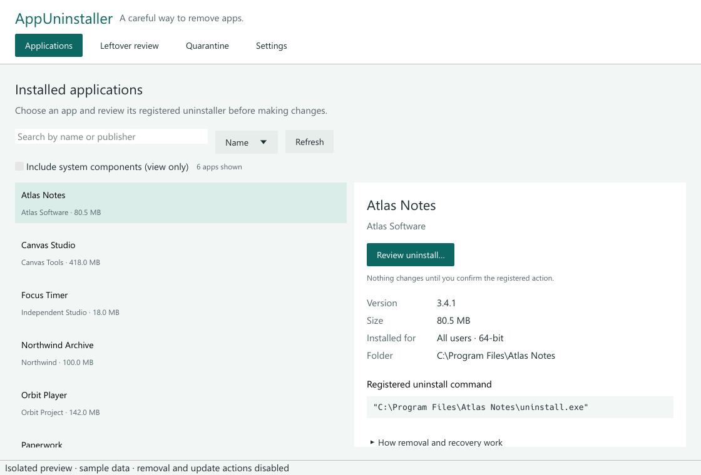
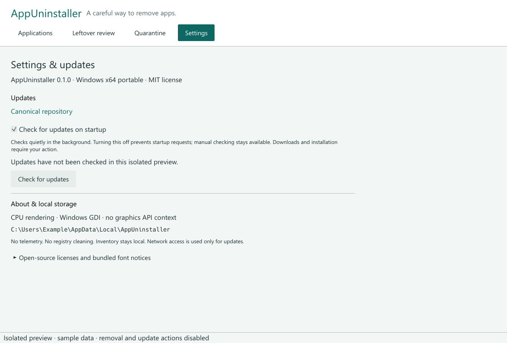
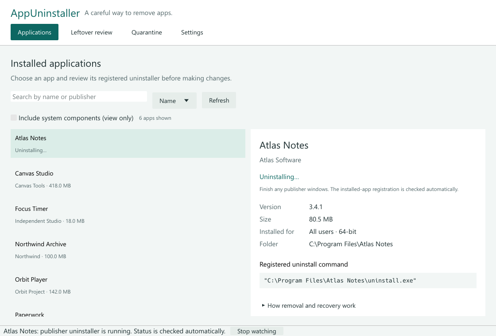
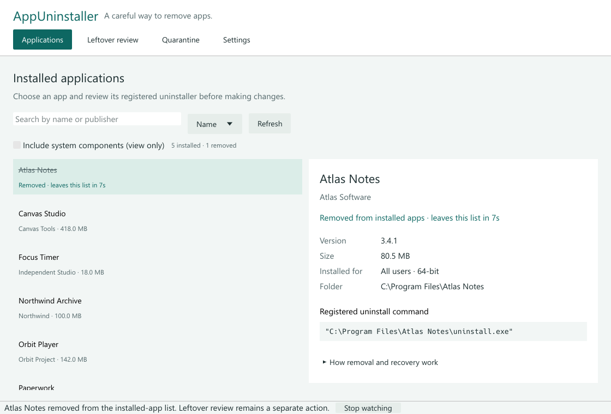
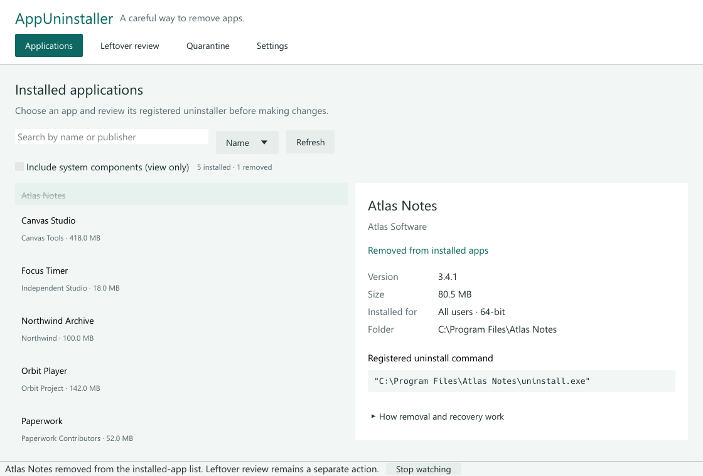
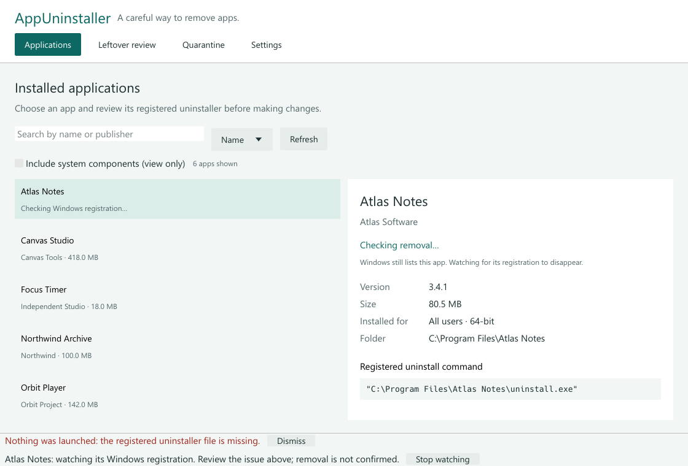
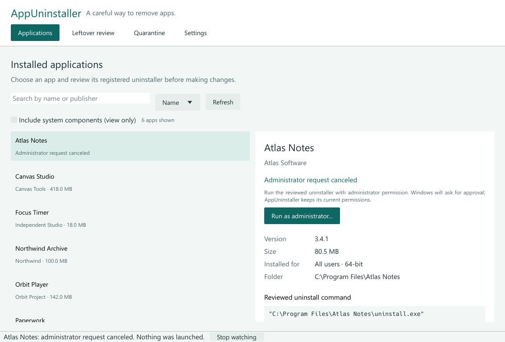
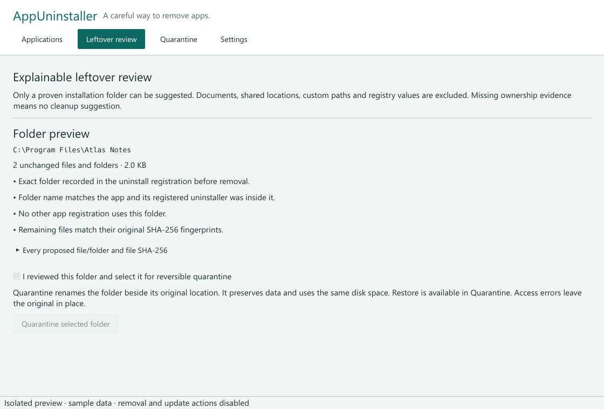

# AppUninstaller

A Windows desktop application for reviewing installed programs, running their registered uninstallers, and deciding what to do with proven leftovers. Original implementation and interface; no affiliation with Revo or use of competitor code/assets.

**Status:** local version 0.1.2. Windows x64 is the packaging target. The repository and releases have not been published. CPU/GDI rendering, isolated idle/hidden/restore behavior and static UI screenshots have been checked. Destructive live workflows and final hands-on responsiveness remain pending.

## What works in the code

- Read-only inventory of current-user/all-users registrations in 32-bit and 64-bit registry views. Shows publisher, version, estimated size and registered icon when supplied. Mirrored registrations are merged; search and sorting are available.
- A two-step uninstall workflow: inspect the executable and arguments, explicitly accept, then run the publisher's registered action. Commands never pass through `cmd`, PowerShell or interpolated shell text. MSI registrations use their validated product code with interactive `/x` and `/norestart`.
- If Windows reports that administrator permission is required (error 740), offer **Run as administrator…** for that reviewed uninstaller. Clicking it revalidates the registration and requests Windows UAC approval. AppUninstaller keeps its own permissions. Canceling UAC launches nothing and allows another explicit retry.
- Automatic observation of the selected removal. Two consecutive checks must find its Windows registration absent before the row is marked removed. It stays visible with a 10-second countdown, then fades and collapses in 260 ms. A missing uninstaller or process exit alone never counts as removal.
- Bounded ownership evidence captured before removal. After the registration disappears, review only unchanged items in the exact registered installation folder. Every suggested path has an explanation and file SHA-256; nothing is selected by default.
- Reversible quarantine by same-volume folder rename, with a flushed JSON recovery journal written first. Restore refuses to overwrite an existing original folder or restore changed quarantine contents. Quarantine retains the same disk usage; permanent deletion remains manual.
- Settings with installed version, **Check for updates**, persistent **Check for updates on startup** (enabled by default), release notes, progress and user-initiated **Download and install**. A separate confirmation restarts into the verified update. The verified new EXE acts as a helper after exit, retains `previous.exe` during replacement, and rolls back failed replacement/restart attempts.
- One bounded background worker for registry, filesystem, process and network work; a virtualized inventory and reactive egui desktop UI. Only an active removal session checks its exact registration once per second; it does not rescan the inventory or reload icons. Unchanged observations do not repaint. Unchanged scenes skip rasterization; native exposure can reuse the retained bitmap. Ordinary settled hidden windows do not build or draw the UI.

## Build and review

Requires a Windows x64 Rust MSVC toolchain (Rust 1.95 or later; verified with 1.96.1), the MSVC linker and Windows SDK. The UI uses egui 0.33.3 with CPU rasterization and Win32 GDI presentation. The application creates no OpenGL, DirectX or Vulkan context. No WebView runtime, installer, service, driver or external AI runtime is needed. The x64 release statically links the MSVC runtime where supported.

```powershell
Set-Location E:\work\github\app-uninstaller
./scripts/check.ps1 -Offline
./scripts/package.ps1 -Offline
```

The source checkout requires the sibling `../rust-auto-updator/crates/rust-auto-updator` workspace (the reusable update core). Obtain both sources together; the updater is not yet published as a registry package, and standalone CI must provision this sibling before building.

Omit `-Offline` only when dependency downloads are available and desired. Cargo uses two jobs and this repository's `target` folder. Packaging writes `dist/AppUninstaller-v0.1.2.exe`, `SHA256SUMS.txt` and license notices. It never executes the application or publishes anything. Run the EXE manually only when interactive testing is authorized.

The executable contains third-party license/font notices under Settings; `THIRD_PARTY_NOTICES.txt` also accompanies packaged artifacts. Refresh it after dependency changes with `python scripts/notices.py` using the local Cargo cache.

## Removal and recovery

1. Choose an application in **Applications**, then **Review uninstall…**.
2. Read the publisher, executable, arguments and ownership limitation. Check the consent box and select **Run registered uninstaller**. If Windows requires elevation, use **Run as administrator…** and approve the Windows prompt. Canceling it does not start the uninstaller; registration observation continues.
3. Complete all publisher windows. AppUninstaller watches the selected registration in both registry views, including after a launcher exits. Confirmed removal shows **Removed** and a 10-second countdown before the row smoothly disappears. If the registration returns, the countdown is canceled. Read errors keep the item visible; a missing uninstaller file is a launch error, not proof of success.
4. If ownership evidence is available and the publisher process has exited, open **Leftover review**, confirm that all publisher windows finished and request a review. A remaining registration blocks quarantine. Restart-required exit codes disable leftover quarantine for that session.
5. Review the folder, ownership evidence and individual file/folder preview. Explicitly select the folder, then quarantine it.
6. In **Quarantine**, review the original destination and explicitly restore when needed. Restore preserves data but does not reinstall the application.

Observation continues for up to two minutes after an unconfirmed process exit or failed launch, and has a 30-minute overall limit. Confirmed removal continues to be checked through the countdown; once the process has exited, observation ends at least 12 seconds after confirmation. **Stop watching** stops observation without terminating the publisher's process. Update operations pause during observation. Other applications are refreshed on request; this is not a system-wide uninstall monitor.

Settings and recovery journals live in `%LOCALAPPDATA%\AppUninstaller`. Quarantine folders are siblings of the original folder, named `.AppUninstaller-quarantine-<UUID>`, so the move stays on the same volume and preserves file data, ACLs and streams. If access is denied, the original stays in place and an error explains the limitation. The administrator retry applies only to the publisher's uninstaller; it does not elevate AppUninstaller, quarantine, restore or the updater. Windows policy can still refuse the request, in which case the error is shown.

Keep the JSON journal with its quarantine folder. If the journal is lost, the folder can be recovered manually by renaming it to its original name while that name is absent. Do not permanently delete quarantine data until you have verified that you no longer need it.

## Deliberate limits

- Inventory covers classic registry-based desktop applications, not a full MSIX/Store, Windows feature, extension or portable-program inventory. Missing metadata remains unknown. Estimated size is publisher metadata, not measured disk usage.
- Shell/script-host commands, network executables, ambiguous unquoted paths and MSI commands without validated product registrations are refused. No forced or batch uninstall, process termination, automatic elevation, registry editing or registry cleaning is implemented.
- Ownership review requires an exact application-name folder directly under Program Files or AppData, a registered uninstaller inside it, no overlapping registration, no protected/shared root and no symbolic links/reparse points. Versioned/vendor-nested/custom folders, most MSI installations and separately stored application settings often lack this evidence and receive **no cleanup suggestion**. The app does not guess AppData or registry ownership from names.
- Capture is limited to 5,000 tree entries, 512 MiB of file contents and 32 folder levels. New/changed files or folders invalidate a preview. Hidden entries are included. Encrypted/offline files and reparse points are excluded.
- Quarantine is selected at the proven-folder level; individual files are previewed but cannot be separately removed. Ownership evidence is session-only. Closing the app loses an unfinished removal review; existing quarantine journals remain recoverable.
- File hashes and repeated checks protect ordinary review mistakes, not hostile concurrent filesystem/registry mutation. Do not run simultaneous cleaners/installers against the same folder. A directory rename is not an OS restore point and cannot undo the publisher's actions.
- Only Windows x64 portable releases are selected for updates. No release currently exists: an unavailable repository/release is reported as unavailable, never “up to date.” Installation requires a writable EXE folder and a supplied SHA-256 digest or matching `SHA256SUMS.txt`. Checksums use the same GitHub trust channel; Authenticode signing is not configured.
- Reusable release validation, HTTPS download, SHA-256/PE checks, atomic replacement, rollback and safe cleanup live in `rust-auto-updator`. Staging uses `.AppUninstaller-update-*` beside the EXE; cleanup starts only after the updated native host initializes. Settings and quarantine data stay outside staging. Reports from older helpers remain readable on migration. A successful launch request does not prove that every new screen is usable.
- In-place updates preserve the original launch path. If that filename contains an older version, Settings shows the actual installed binary version; newly published download assets still use their correct versioned filenames.

## Verification and screenshots

See [verification record](docs/VERIFICATION.md), [architecture](docs/ARCHITECTURE.md), [manual validation](docs/MANUAL_TESTS.md) and [initial release notes draft](docs/RELEASE_NOTES.md).

These are real client-area PNGs saved by the packaged application's production UI components and CPU rasterizer. They use deterministic sample registrations, contain no personal inventory, and do not show native Windows chrome. All actions are disabled in capture mode.



Installed applications: a focused list, readable installation details and a review action visible without scrolling, including at the minimum supported width.



Settings: installed version, persistent startup-check preference, manual update checking and local recovery storage.



Removal in progress: the row and details show the current state without asking the user to launch the same action again.



Confirmed removal: the sample app is marked removed, with seven seconds remaining in its 10-second grace period. The installed count excludes it immediately.



Halfway through the finite collapse: the row fades while neighboring items move up. Rendering stops again after the transition.



Launch failure: the error says that nothing was launched. Registration observation remains available without claiming that an uninstaller is running or that the app is removed.


Administrator permission: an actionable state replaces the raw error 740. The reviewed executable and arguments remain visible before requesting UAC.



Canceled request: nothing was launched, the app remains in the list, and another user-initiated retry is available. These images show AppUninstaller's real screen with fixture state, not the Windows UAC dialog.



Leftover review: ownership evidence and an unchecked selection before reversible quarantine. This is sample leftover data rendered by the real screen; no real application was uninstalled.

To reproduce static captures without desktop automation:

```powershell
./scripts/capture.ps1
```

Each capture runs offscreen, waits for stable layout, saves a PNG plus metadata, and exits with a finite frame/time budget. `--screenshot ABSOLUTE_PATH --screen SCREEN [--size WIDTHxHEIGHT]` is a developer-only mode, not part of consumer settings. Screens include `applications`, `settings`, `leftovers`, `quarantine`, `applications-unavailable`, `applications-removing`, `applications-removed`, `applications-collapsing`, `applications-administrator` and `applications-uac-cancelled`. Temporal screenshots freeze the fixture clock. Captures verify visual layout, not keyboard/mouse behavior or normal hidden operation.

For the separate bounded runtime gate, run `./scripts/verify-rendering.ps1`. It uses 840 isolated sample registrations and a live removal-row transition, shows/hides/restores only its own nonactivating, pointer-transparent test window, records CPU and actual UI/raster/presentation counters, and exits after three settled five-second intervals (36-second internal limit). It never accesses the registry, network, normal settings or real leftovers. A nonzero input count invalidates a quiet sample. See the evidence record for results and remaining limits.

## License

[MIT](LICENSE). Dependency and font terms appear in [third-party notices](THIRD_PARTY_NOTICES.txt).
